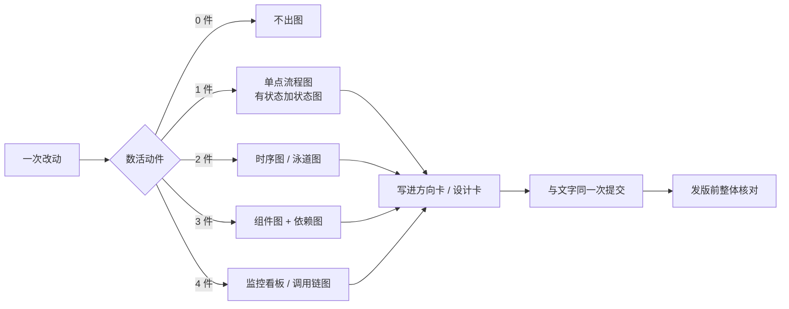

# 系统可视化：按改动量出图，图内联在文档里

## 为什么需要它

先做出可操作的界面、再借界面操作构思系统功能，是有效的发现手段；系统工作的流程图同样能帮人看懂一件事怎么走。

但这不改变文档的唯一事实源地位：**图是文档的一种读法，不是第二份事实**。界面与流程图只负责把系统摆出来，结论仍写回文档。

## 三条底线

| 底线 | 做法 | 不这么做会怎样 |
|---|---|---|
| 归属 | 图归在文档名下：方向卡放**系统现状图**（方向确立时），设计卡放**本次改动图**（设计门、拆任务前） | 图与文字各说一套，出现第二个事实源 |
| 形式 | **内联在文档里**，用能像文字一样编辑比对的方式（Mermaid / ASCII / Markdown 表 / 内联 SVG），不用截图 | 截图不能 diff，改一次就要重截一次 |
| 维护 | 同一次提交；以文字为准（图文不符重画图）；机器只查「有没有图 / 指针空不空」，画得对不对靠人 | 图慢慢变成装饰，读者不再信它 |

## 分档：按本次改动的活动件数

判据是**这次改动会动到几个活动件**，不是系统有多大。0 件就不出图——给纯措辞、纯格式、行为不变的重构画图，是把设计门变成填表仪式。

| 本次改动的活动件 | 出什么图 | 回答什么问题 |
|---|---|---|
| 0 件（措辞 / 格式 / 行为不变的重构） | 不出图 | — |
| 1 件单点 | 流程图；有状态就加状态图 | 这一步怎么走、有哪些状态 |
| 2 件有交互 | 时序图或泳道图 | 谁在什么时候调用谁、失败回哪 |
| 3 件有边界 | 组件图 + 依赖图 | 边界在哪、依赖朝哪、改动会波及谁 |
| 4 件要追因 | 监控看板或调用链图 | 出问题时从哪几个信号追下去 |
| 横切：有界面 | 界面原型 | 页面有哪些区域、操作后看到什么 |
| 横切：用户路径变 | 用户旅程图 | 用户从哪来到哪去、哪里卡住 |

「一件是多大的事」由人判；机器不数活动件，也不猜该画哪张图。

## 需求线：需求落位

可视化不是「界面」与「系统设计」两层，而是两根轴上的取舍：**层次轴**（用户看得到的界面 / 操作 ↔ 系统内部的结构）与**时间轴**（现状 ↔ 目标）。方向卡的「系统现状图」回答的是「现在系统怎么走」，设计卡的「可视化」回答的是「这次改动动到哪」。

需求线缺的是两者的**差异视图**：一条需求被确认后、进入设计前，画出「它落在系统的哪些组件、接口、数据或页面，现状是什么、目标是什么、接缝在哪」。这张图叫**需求落位**，写进设计卡「需求落位」一节（回看之后、接口之前）。

| 轴 | 一端 | 另一端 | 载体 |
|---|---|---|---|
| 层次 | 界面 / 操作 | 系统结构 | 看需求是否碰到页面、是否有界面原型 |
| 时间 | 现状 | 目标 / 本次改动 | 看「系统现状图」（现状）与「可视化」（本次改动） |
| 需求线 | — | — | **需求落位**＝差异视图：需求当前落在哪、目标落在哪、接缝在哪 |

规则与「可视化」一致：只画被这条需求碰到的节点与接缝，0 活动件写「无（0 活动件）」；与「可视化」图是同一张时只画一次，不各画一份；图与文字同一次提交，图文不符时以文字为准。

## 15 种图目录

目录不是必填清单，**选一张能回答当前问题的就够**；同一个问题不要画两张。

| # | 图 | 回答什么问题 | 典型落点 | 文本形式 |
|---|---|---|---|---|
| 1 | 流程图 | 步骤、分支、先后 | 方向卡 / 设计卡 | Mermaid `flowchart` |
| 2 | 状态图 | 对象有哪些状态、怎么迁移 | 设计卡（有状态机） | Mermaid `stateDiagram-v2` |
| 3 | 时序图 | 谁先调用谁、失败回哪一步 | 设计卡（≥2 组件交互） | Mermaid `sequenceDiagram` |
| 4 | 泳道图 | 每个角色 / 组件负责哪一段 | 设计卡（跨角色流程） | Mermaid `flowchart` + `subgraph` |
| 5 | 组件图 | 系统由哪些部件组成、边界在哪 | 方向卡系统现状图 / 技术设计 | Mermaid `flowchart` + `subgraph` |
| 6 | 依赖图 | 谁依赖谁、改一处会波及哪 | 设计卡（边界改动） | Mermaid `flowchart LR` |
| 7 | 数据流图 | 数据从哪来、到哪去、在哪落库 | 设计卡 / 技术设计 | Mermaid `flowchart` |
| 8 | 实体关系图 | 实体、字段、关系 | 技术设计 | Mermaid `erDiagram` |
| 9 | 调用链图 | 一次请求经过哪些服务、慢在哪 | 设计卡（追因） | 文本树 / Mermaid `sequenceDiagram` |
| 10 | 监控看板 | 运行时要看哪几个指标、阈值多少 | 观测地图 | Markdown 表（指标 / 阈值 / 窗口） |
| 11 | 界面原型 | 页面有哪些区域、操作后看到什么 | 方向卡（有界面）/ PRD | ASCII 线框 / 内联 HTML |
| 12 | 用户旅程图 | 用户从哪来到哪去、哪里卡住 | 方向卡（用户路径变） | Markdown 表（阶段 / 动作 / 卡点） |
| 13 | 决策树 | 在哪个条件走哪条分支 | 设计卡（分支多） | Mermaid `flowchart` |
| 14 | 部署图 | 进程 / 容器 / 宿主怎么摆 | 技术设计（发版或部署变） | Mermaid `flowchart` |
| 15 | 思维导图 | 这个概念包含哪些子项 | 方向卡（范围讨论） | Markdown 列表 / Mermaid `mindmap` |

## 归属与环节

| 载体 | 放什么图 | 什么时候画 | 人核什么 |
|---|---|---|---|
| 方向卡「系统现状图」 | **现在**系统怎么走（不是目标态） | 方向确立时 | 图是否覆盖方向路径的每一步 |
| 设计卡「需求落位」 | 这条需求落在哪些组件 / 接口 / 数据 / 页面，现状 → 目标 → 接缝（差异视图） | 需求确认后、设计门前 | 落位表每条需求有行；接缝非空或写「无（为什么）」；图只画被碰到的节点 |
| 设计卡「可视化」 | 本次改动图 | 设计门、拆任务前 | 图是否与「接口」「失败边界」对得上 |
| 发版前整体核对 | 全库图 | 发版前 | 图与文字是否一致；不一致以文字为准并重画 |

## 查的时机

- **改到哪查哪**：每次改文档或代码，先看对应卡里的图是否仍成立；不成立就在同一次提交里重画。
- **需求确认时查落位**：一条需求确认后、设计门前，先看「需求落位」表与图是否把这条需求与系统的结合点讲清楚。
- **发版前整体查**：发版前把全库图和文字对照一遍，不带错图发版。
- **两条叠用**：前者防积压，后者防漏网；只做发版前那一次，图会过期一整版。

## 维护三规则

1. **同一次提交**：图与它描述的文字一起改，不分成两次提交。
2. **以文字为准**：图文不符时先信文字，再重画图；不要为了让图好看去改文字。
3. **机器只判形式**：脚本能查「图位在不在 / 指针空不空」，判不了「画得对不对」；对错由人读。

## 一张示例

下面这张图本身也是内联图，可以像文字一样改：

本轮改动是纯文档规则（0 活动件），所以设计卡「可视化」格写「无（0 活动件）」——这本身就是分档在起作用。
